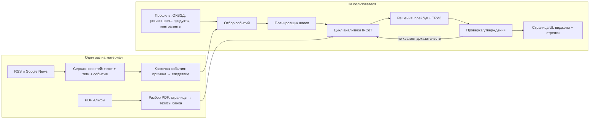

# Предложение: архитектура рассуждения «новость → аналитика → решение»

Статус: **черновик на обсуждение командой**, не утверждён. Затрагивает все модули: сбор и тегирование (Саша),
граф (Тимофей), ранжирование (Лев), материалы Альфы (Арсен), UI (Арсентий).

Документ продолжает [предложение конвейера отбора](proposal-ranking-pipeline.md): там решено, *какие* новости
показать. Здесь — *как* из отобранных новостей получить аналитику и решения так, чтобы каждый вывод можно было
проследить до источника.

## Коротко

1. Каждая колонка UI — один шаг причинной цепочки: **факт** (новость) → **механизм влияния на эту компанию**
   (аналитика) → **действие** (решение). Каждая стрелка в UI — это шаг рассуждения со своими доказательствами.
2. Шаг «аналитика» строится циклом в стиле **IRCoT**: модель пишет одно предложение рассуждения, по нему ищет
   подтверждение (новости недели, тезисы Альфы, контрагенты клиента), затем пишет следующее. 1–3 итерации.
3. Шаг «решение» — **плейбук роли** плюс **ТРИЗ**: из аналитики выделяется противоречие, к нему применяются приёмы
   из фиксированного списка.
4. Перед показом — **самопроверка** в стиле Chain-of-Verification: каждое утверждение сверяется с цитатой
   источника; неподтверждённое отбрасывается или уходит на повторный поиск.
5. **PDF Альфы** один раз превращаются в «тезисы банка» с цитатой и страницей — тот же формат, что у новостей,
   только с источником `alfa`.

Из обсуждавшихся методов сознательно **не берём**: ReAct (свободный агентный цикл ненадёжен на малых моделях —
авторы IRCoT отмечают, что ReAct опирается на очень большие модели и дообучение), отдельные Query2doc и Step-back
(их роль уже выполняет развёртка профиля в «информационные потребности»), Adaptive-RAG с обученным классификатором
(заменяем простым правилом глубины поиска, см. «Самопроверка»).

## Что требует бриф и где это закрывается

| Требование брифа | Где в архитектуре |
|---|---|
| Планирование шагов | Планировщик: по профилю и событию выбирает типы шагов (прямой, через контрагентов, через продукты банка) |
| Работа с инструментами | Фиксированный набор инструментов только для чтения (раздел «Инструменты») |
| Общий контекст шагов | Журнал цепочки: все шаги, запросы и найденные доказательства одного события |
| Самопроверка и адаптация | Проверка утверждений, повторный поиск при нехватке доказательств, понижение уверенности при противоречиях |
| Отделять факт, позицию банка и вывод модели | Тип каждого утверждения: `fact` / `alfa` / `inference` / `user` |
| Аналитика Альфы влияет на выводы | Тезисы Альфы ищутся первыми на шаге аналитики и имеют больший вес |
| Учитывать особенности компании, а не только отрасль | Шаги через контрагентов (платежи) и продукты банка (кредит, лизинг, депозиты, ВЭД) |
| Трассируемость | Каждое утверждение хранит ссылки на источник, цитату, признаки компании и номер шага |
| Безопасность AI-компонента | Инструменты только на чтение, белый список, журнал вызовов, лимиты (раздел «Безопасность») |

## Что уже есть в репозитории

| Часть | Состояние | Что берём |
|---|---|---|
| UI (`ui/`) и контракт [ENDPOINTS](ENDPOINTS.md) | Работает на моке | Три колонки, стрелки с текстом связи, теги `source` (ai/alfa/human), `confidence`, `urgency`, чат с `basis` и патчами страницы |
| Сервис новостей (Go, ветка `tags`, ещё не в `main`) | Сбор RSS, тегирование, HTTP API | Статьи с текстом, теги с дословной цитатой, события со статусом `observed` / `announced_planned` / `forecast`; общий LLM-клиент с поддержкой tool calls и только разрешёнными моделями |
| Словарь тегов v1 (ветка `tags`) | Зафиксирован | 112 отраслей ОКВЭД, 365 географических меток, 8 ресурсов, 36 типов событий |
| Сборщик `v1/` (Арсентий) | Экспериментальный | Поисковые запросы по 11 блокам (конкуренты, регулирование, поставщики…), Google News + 50 лент |
| Предложение отбора (Лев) | Черновик | Развёрнутый профиль, поиск по эмбеддингам, диверсификация, карточка события с парами «причина → следствие» |

Статус события из словаря (`observed` / `forecast`) — готовое разделение «подтверждено / предположение», которое
требует бриф. Его нужно пронести до UI.

## Общая схема



## Единица данных: утверждение

Всё, что видит пользователь, собирается из утверждений. У каждого утверждения есть тип и доказательства.

```json
{
  "id": "c17",
  "kind": "inference",
  "text": "Сохранение ставки 14% удерживает стоимость обслуживания плавающего долга компании на текущем уровне.",
  "status": "forecast",
  "confidence": "probable",
  "evidence": [
    {"type": "news", "ref": "news:1842", "quote": "Совет директоров Банка России принял решение сохранить ключевую ставку на уровне 14%"},
    {"type": "alfa", "ref": "alfa:keyrate-14:p2:t3", "quote": "…"},
    {"type": "profile", "ref": "profile:CL_PRODUCT_LOA_MARK", "quote": "есть кредитные продукты"}
  ],
  "step": "hop2.iter1"
}
```

| `kind` | Что это | Тег в UI |
|---|---|---|
| `fact` | Пересказ новости, у которой есть цитата | источник новости |
| `alfa` | Позиция банка из тезиса Альфы | `source: alfa` |
| `inference` | Вывод модели из фактов и тезисов | `source: ai` |
| `user` | Создано или изменено по словам пользователя в чате | `source: human` (правило уже в ENDPOINTS) |

`confidence` выставляется правилом, а не моделью: `reliable` — все доказательства `observed` и есть тезис Альфы
в ту же сторону; `probable` — есть подтверждение, но часть доказательств — прогноз; `possible` — одно доказательство
или решение по ТРИЗ. Точные пороги — открытый вопрос.

## Причинная цепочка: три шага = три колонки

| Шаг | Колонка UI | Вопрос | Откуда доказательства |
|---|---|---|---|
| hop1 | Самые важные новости | Что произошло? | Текст новости, теги и события со статусом |
| hop2 | Аналитика | Что это значит для этой компании? | Другие новости недели, тезисы Альфы, профиль, контрагенты |
| hop3 | Советуемые решения | Что можно сделать? | Утверждения hop2, плейбук роли, продукты банка |

Цепочка считается **по каждой отобранной новости отдельно**: одна новость даёт свою аналитику и свои решения.
Страница — это набор таких цепочек, а не одна записка на всю неделю. Новости недели и тезисы Альфы подмешиваются
внутрь цепочки как доказательства, а не как отдельные решения. Стрелка `новость → аналитика` хранит текст шага
hop2, стрелка `аналитика → решение` — текст шага hop3. Это ложится в существующий `GET /api/links/{id}`.

### Типы шага аналитики

Планировщик выбирает, через что событие доходит до компании. Это даёт «не простое следствие из одной новости»,
которого требует бриф.

| Тип | Пример | Нужные данные |
|---|---|---|
| Прямой | Новость об отрасли клиента | ОКВЭД клиента |
| Через продукт банка | Ставка ЦБ → стоимость кредита → нагрузка на компанию с кредитом | Флаги продуктов `CL_PRODUCT_*`, `FACTORING_MARK` |
| Через контрагентов | Проблемы в отрасли X → контрагенты клиента из X дают N % входящих платежей → риск выручки | Платежи `PAYER`/`BENEFICIARY`, ОКВЭД контрагентов |
| Через ресурс | Цена газа → издержки отраслей, где газ — сырьё | Ресурсные теги словаря |
| Через внешнюю торговлю | Пошлины или санкции страны → компания с данными ФТС по этой стране | `FTS_FLAG`, `FTS_COUNTRY_NAME` |

Пары «причина → следствие» из карточки события — готовые заготовки первого предложения hop2. Граф Тимофея даёт
путь «раздел события → раздел клиента» для объяснения «почему мне это показали».

## Агентный цикл шага аналитики (IRCoT)

Идея IRCoT: что искать дальше, зависит от уже выведенного, а выведенное — от найденного. Поэтому поиск
и рассуждение чередуются, а не идут одним запросом.

1. На вход: событие (hop1), профиль, выбранный тип шага.
2. Начальный поиск по самому событию: тезисы Альфы, связанные новости недели.
3. Модель пишет **одно** следующее предложение рассуждения, ссылаясь на найденное.
4. Это предложение становится новым поисковым запросом; найденное добавляется в журнал цепочки.
5. Повторяем, пока модель не напишет итоговый вывод или не исчерпан лимит (3 итерации).
6. Итог hop2 — 1–3 утверждения типа `inference` или `alfa` с доказательствами.

Чем это отличается от ReAct: модель не выбирает свободно любой инструмент на каждом шаге. Порядок фиксирован
кодом, модель только пишет следующее предложение. Для моделей с ~3–4B активных параметров это надёжнее.

### Инструменты (только чтение)

| Инструмент | Что возвращает | Чей модуль |
|---|---|---|
| `get_profile(company_id)` | ОКВЭД, регион, размер, продукты банка, данные ФТС | ранжирование |
| `get_counterparties(company_id, okved?)` | Контрагенты, их ОКВЭД, доли платежей | граф |
| `search_news(query, period, tags?)` | Новости с цитатами тегов и статусами событий | сервис новостей |
| `search_alfa(query, tags?)` | Тезисы Альфы с цитатой, страницей и датой | материалы Альфы |
| `get_article(id)` | Полный текст для проверки цитаты | сервис новостей |

Инструменты исполняет наш сервис, LLM-клиент из ветки `tags` уже умеет передавать tool calls и результаты.

## Шаг решений: плейбук + ТРИЗ

1. **Плейбук роли** даёт стандартные решения (для финдиректора — долг, ликвидность, хеджирование; для главбуха —
   налоги и отчётность), как в предложении отбора.
2. **ТРИЗ** даёт 1–2 нестандартных:
   - из утверждений hop2 модель выделяет противоречие «хотим улучшить X, но ухудшается Y»
     (например, «сохранить инвестпрограмму, но долг дорожает»);
   - выбирает 2–3 приёма из **фиксированной таблицы приёмов ТРИЗ с деловым толкованием** (таблицу составляем
     заранее, модель приёмы не придумывает);
   - по каждому приёму пишет конкретное действие со ссылкой на утверждения hop2.

   Пример: «предварительное действие» → зафиксировать ставку по части заимствований до заседания ЦБ;
   «дробление» → разбить заимствование на транши; «посредник» → часть закупок через лизинг банка
   (нативная реклама продукта, разрешена брифом).
3. Решения по ТРИЗ получают `confidence: possible` и отметку приёма, чтобы пользователь видел, что это гипотеза.
4. Решение без ссылки на утверждение hop2 не показывается.
5. К решению добавляется матрица рисков (`GET /api/widgets/{id}/risks`) и, если уместно, предложение банка
   (`bank_offer`).

## Самопроверка и адаптация (Chain-of-Verification)

1. **Ссылки.** Все ID источников есть в журнале цепочки; цитаты дословно встречаются в тексте источника — проверка
   кодом, без LLM.
2. **Утверждения.** Один пакетный вызов LLM: по каждому утверждению — проверочный вопрос и ответ только по
   приложенным цитатам: «подтверждено / не подтверждено / противоречит».
3. **Реакция:**
   - не подтверждено → ещё одна итерация hop2 по этому утверждению (если лимит не исчерпан), иначе утверждение
     отбрасывается;
   - противоречит тезису Альфы → показываем обе позиции и понижаем `confidence`;
   - прогноз выдан за факт → исправляем `status` на `forecast`.
4. **Глубина поиска по сложности** (замена Adaptive-RAG): если у события есть тезис Альфы и прямое совпадение
   ОКВЭД — 1 итерация; если связь через контрагентов или ресурс — до 3; если после 3 итераций доказательств
   нет — событие не попадает в аналитику.

## PDF Альфы: как сделать читаемыми для LLM

В брифе перечислены материалы Центра макроэкономических исследований (инфляция, «Бонд Бриф», золото, тактический
взгляд на квартал, commodities, ключевая ставка, макростатистика, потребление). Конвейер должен принимать
**любой новый PDF** без ручной подгонки под конкретный файл.

Модель не читает PDF целиком — она получает **тезисы банка**: короткие проверяемые утверждения с цитатой
и страницей.

### Пошагово

1. **Приём файла.** PDF кладётся в папку или загружается; ID документа — хеш файла, повторная загрузка не плодит
   дубли. Сохраняются название, дата выпуска, серия («Бонд Бриф», «Инфляция»…).
2. **Текст по страницам.** Извлекается текстовый слой постранично с сохранением номера страницы. Библиотека —
   открытый вопрос.
3. **Таблицы и графики.** Страницы, где мало текста или есть изображения, отдаются Qwen3-VL-30B-A3B-Instruct
   (разрешённая мультимодальная модель): описание графика или таблицы — какой показатель, период, направление,
   ключевые значения. Описание помечается как полученное из изображения.
4. **Разбиение на тезисы.** LLM по каждой странице выделяет тезисы в фиксированном формате (ниже). Каждый тезис
   обязан иметь дословную цитату со страницы.
5. **Проверка кодом.** Цитата ищется в тексте страницы (после нормализации пробелов и переносов); тезисы без
   найденной цитаты отбрасываются. Теги проверяются по словарю v1.
6. **Индексация.** Тезисы получают те же теги словаря, что новости (отрасли, ресурсы, типы событий, география),
   и эмбеддинг — тогда `search_alfa` ищет их тем же способом, что новости.
7. **Свежесть.** У тезиса есть дата документа; при выходе новой версии той же серии старые тезисы помечаются
   устаревшими, но остаются для истории.

### Формат тезиса

```json
{
  "id": "alfa:<doc_hash>:p3:t2",
  "doc": {"title": "Ключевая ставка ЦБ РФ: …", "series": "Ключевая ставка", "published": "2026-09-11"},
  "page": 3,
  "quote": "дословная цитата со страницы",
  "claim": "Банк ожидает … (пересказ одной мыслью)",
  "indicator": "ключевая ставка",
  "direction": "up | down | flat | null",
  "value": "14,0%",
  "horizon": "до конца 2026",
  "status": "observed | forecast",
  "from_image": false,
  "tags": ["event:monetary_policy_decision", "geography:country:RU"]
}
```

В UI тезис показывается с `source: alfa` и ссылкой на документ и страницу; пользователь видит, где позиция банка,
а где вывод модели.

## Контракты и что меняется в модулях

- **UI (Арсентий):** текущий контракт ENDPOINTS покрывает виджеты, стрелки, теги и чат. Предлагается обсудить
  добавление в `GET /api/widgets/{id}` списка `basis` (утверждения с типом и ссылками) — сейчас `basis` есть только
  в ответе чата.
- **Сервис новостей (Саша):** нужен поиск для `search_news` (сейчас фильтр по тегу и дате) и, возможно, поле пар
  «причина → следствие» в карточке события. Сервис новостей — естественное место и для хранения тезисов Альфы
  (тот же словарь, те же цитаты).
- **Граф (Тимофей):** `get_counterparties` по данным платежей и путь «раздел события → раздел клиента» для объяснений.
- **Ранжирование (Лев):** `get_profile`, отбор событий, планировщик, цикл hop2, проверка.
- **Материалы Альфы (Арсен):** конвейер разбора PDF и таблица приёмов ТРИЗ с деловым толкованием.

## Бюджет LLM (оценка, требует замера)

| Этап | Когда | Вызовов |
|---|---|---|
| Тегирование и карточка события | один раз на новость | уже есть в сервисе новостей |
| Разбор PDF | один раз на документ | 1 на страницу + 1 на страницу с графиком |
| Развёртка профиля | один раз на комбинацию параметров, кэш | 1 |
| Планировщик | на пользователя | 1 |
| hop2 | на каждое показанное событие | 1–3 |
| hop3 (решения + ТРИЗ) | на пользователя, пакетом | 1–2 |
| Проверка | на пользователя, пакетом | 1 |

Для страницы из ~6 событий это порядка 10–20 вызовов на пользователя. Результаты кэшируются по паре «профиль ×
неделя новостей»: пользователи с одинаковыми параметрами получают ту же страницу. Реальный расход в токенах и рублях
нужно замерить на одобренных моделях до утверждения.

Выбор модели по шагам (по рекомендациям брифа, проверить замером): извлечение и тегирование — Gemma 4 26B A4B;
рассуждение hop2 и hop3 — GLM-5.3-Flash или DeepSeek-V4.1-Flash; графики в PDF — Qwen3-VL-30B-A3B-Instruct.

## Безопасность и трассировка

- Все инструменты только читают данные; изменения страницы — только через патчи, описанные в ENDPOINTS.
- Белый список инструментов и параметров; результат инструмента подаётся модели как данные, а не инструкции.
- Каждый вызов LLM и инструмента пишется в журнал цепочки: шаг, модель, запрос инструмента, найденные ID,
  токены. По журналу восстанавливаются источники, признаки компании и промежуточные шаги любого вывода.
- В LLM уходят только обезличенные признаки компании из датасета; ключи и настройки не логируются
  (так уже сделано в LLM-клиенте).
- Лимиты: итераций hop2, вызовов на пользователя, дневной бюджет (бюджетная пауза уже есть в сервисе новостей).

## Метрики и мониторинг

| Что меряем | Как |
|---|---|
| Обоснованность | Доля утверждений, прошедших проверку; доля выдуманных ссылок (должна быть 0 после проверки) |
| Вклад Альфы | Доля страниц, где есть хотя бы один тезис `alfa` |
| Глубина | Доля выводов через продукт, контрагентов или ресурс, а не «прямых» |
| Качество записки | Слепая оценка 0–10 на стенде из `exp/` (16 профилей), как в предложении отбора |
| Расход | Вызовы и токены на пользователя и на день |
| Обратная связь | Оценка полезности виджета пользователем, отметки «неверно» в чате |

## Как проверить до внедрения

1. Взять стенд из `exp/` (неделя новостей, 16 профилей) и одну одобренную модель.
2. Сравнить три варианта: текущая записка одним вызовом; hop2 по IRCoT + проверка; то же + ТРИЗ в решениях.
3. Сравнить оценку 0–10, долю подтверждённых утверждений и расход вызовов.
4. Внедрять то, что даёт прирост при приемлемом расходе.

## Этапы

1. Договориться о формате утверждения и тезиса Альфы (этот документ).
2. Конвейер PDF Альфы и `search_alfa`; параллельно `search_news` в сервисе новостей.
3. Цикл hop2 и проверка на стенде, замер расхода.
4. hop3 с плейбуком, затем ТРИЗ.
5. Подключение к UI вместо мока: реальная страница, тексты стрелок, `basis`.

## Пошагово, простыми словами

1. Новости и PDF Альфы один раз разбираются на короткие утверждения с цитатой из источника.
2. Пользователь входит — по его компании отбираются важные события недели.
3. Для каждого события система решает, через что оно может задеть компанию: напрямую, через кредит, через
   контрагентов, через сырьё или внешнюю торговлю.
4. Модель шаг за шагом рассуждает «что это значит для компании», после каждого шага ищет подтверждение
   в новостях, тезисах Альфы и данных компании.
5. Из выводов модель предлагает решения: стандартные для роли и 1–2 нестандартных по приёмам ТРИЗ.
6. Каждое утверждение проверяется по цитатам; неподтверждённое ищется ещё раз или убирается.
7. На странице три колонки, стрелки между ними объясняют шаги, у каждого вывода видно, откуда он: из новости,
   от банка или от модели.

## Реализация

Черновик кода — `reasoning/`. Сбор и отбор новостей не входят в него: на вход берётся уже отобранный пакет из `exp/v2`.

Решения от 2026-10-23: язык Python; PDF лежат в `analytical-papers/` (в git не попадают). Текстовый слой снимает `pypdf`; у этих файлов слоя нет, страница рендерится через `pdftoppm` и читается `qwen/qwen3-vl-30b-a3b-instruct`. Тезис остаётся только если цитата дословно есть в расшифровке страницы. Страница пишется JSON-ом в форме `mock_server/seed.json`, модуль UI не меняется.

Как прогнать один профиль (ключ `LLM_API_KEY` и `LLM_BASE_URL` в корневом `.env`):

```bash
.venv/bin/python -m reasoning.alfa          # PDF -> reasoning/out/theses.jsonl
.venv/bin/python -m reasoning.run U01       # страница -> reasoning/out/U01.json
.venv/bin/python -m reasoning.evaluate U01  # метрики без нового вызова модели
.venv/bin/python -m pytest reasoning/test_chain.py -q
```

`evaluate` считает без модели: цепочки с аналитикой и решением, целые стрелки, выдуманные ID, долю тезисов Альфы, долю решений по ТРИЗ, долю связей не «в лоб» и грубое покрытие эталонных выводов. Покрытие по словам — дымовой сигнал; оценку 0–10 по-прежнему ставит судья-модель другого семейства, это ещё не подключено.

## Открытые вопросы к команде

1. Принимаем ли формат утверждения (`kind`, `status`, `confidence`, `evidence`) как общий формат между модулями?
2. Где хранятся тезисы Альфы: в сервисе новостей (PostgreSQL) или отдельно, как сейчас в `reasoning/out/`?
3. Пороги `confidence` и лимит итераций hop2 (сейчас 3).
4. Нужен ли `basis` в `GET /api/widgets/{id}`?
5. Кто составляет полную таблицу приёмов ТРИЗ? Сейчас в коде пять приёмов с деловым толкованием.
